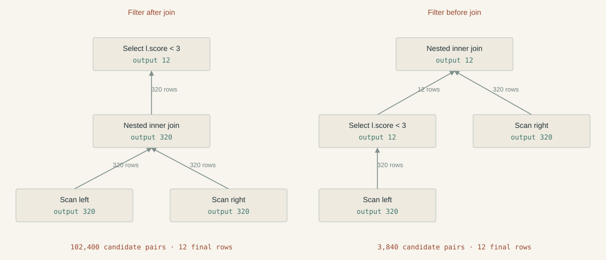

# Relational query engine lab

An iterator-style execution engine for typed relational plans, with SQL three-valued predicates, duplicate-preserving projection, and nested-loop/hash inner and left equijoins. SQLite independently checks the supported semantics through actual local queries.

The repository contains complete inputs, original and optimized plans, outputs, counters, SQLite query parameters and real timing samples. It is a synthetic, AI-assisted database-execution exercise.



## Run

Python 3.13 with its standard-library SQLite module. No external packages are required.

```bash
python -m unittest discover -s tests -v
python -m relab examples/selective_inner.json --optimize --sqlite-check --output build/result.json
python scripts/verify_results.py
python scripts/run_study.py --output-dir build/reproduction
```

Open [the technical report](docs/report.html) directly. Its SVGs and tables are local. The CLI accepts the explicit JSON plan format, not SQL text; exit 0 means a complete result, exit 2 means invalid input, I/O or a declared execution-budget failure.

## Implemented behavior

- **NULL:** comparisons involving NULL return UNKNOWN; WHERE retains only TRUE. AND, OR, NOT and IS NULL follow three-valued semantics.
- **Bags:** duplicate rows remain duplicates. An empty projection returns one empty tuple per input row.
- **Joins:** ordinary equality keys never match NULL. Composite keys, duplicates, deliberate integer hash collisions and unmatched left rows are handled.
- **Rewrites:** combine pure selections, collapse nested projections, push left-only predicates through inner/left joins and right-only predicates through inner joins. Rules preserve input validation limits.
- **Bounds:** 1,024 rows and 16 columns per input table; 31 plan nodes, depth 12; at most 100,000 emitted rows per operator and 2,000,000 candidates per join. Exceeding a limit raises an error without returning a completed partial result.

Only signed 64-bit integers, bounded UTF-8 text and NULL are supported. Mixed-type comparisons are rejected. There is no general SQL parser, ORDER BY, DISTINCT, aggregation, transaction system, disk spill or distributed execution.

## Findings from the recorded run

On two uniform 320-row inputs, a selective left predicate reduces a nested-loop join from **102,400 to 3,840 candidate pairs**, preserving twelve output rows. Hash execution examines **320 candidates**, or **12** with the same pushdown.

Skew exposes unavoidable duplicate work: four keys with eighty rows per input produce **25,600 matches** before filtering. Hash execution with pushdown examines 960 candidates, matching the required output multiplicity.

The unsafe left-join rewrite is preserved as a counterexample: filtering `r.score > 10` after the left join returns **2 rows**, while moving that predicate into the right input and removing the outer filter returns **7 rows**. The optimizer refuses this transformation.

The evidence includes 9 fixed cases, 80 separately seeded preserved cases, 8 benchmark plans and 96 actual timing calls. Tests independently exercise 360 seeded plans across nested, hash and optimized variants. All comparisons use row multisets, not accidental iteration order.

## Review

- [Report](docs/report.html), [screenshots](docs/screenshots/README.md), [recorded review](docs/recordings/README.md)
- [Typed examples](examples/), [fixed plan/output evidence](results/cases/), [randomized oracle corpus](results/oracle-corpus.json)
- [Benchmark inputs, plans and full outputs](results/benchmarks/), [counters](results/benchmark-summary.json), [raw timing CSV](results/timings.csv)
- [Test transcript](results/test-results.txt), [environment](results/environment.json), [provenance](results/provenance.json)
- [Supported semantics](docs/semantics.md), [rewrite reasoning](docs/optimizer.md), [measurement methods](docs/methodology.md)

The algorithms deliberately favor clarity over database performance. Both materialize the right input; the hash implementation adds keyed groups, and the public execution API materializes the final result. Timings are small local instrumented runs, not a SQLite performance comparison or a production database claim.
